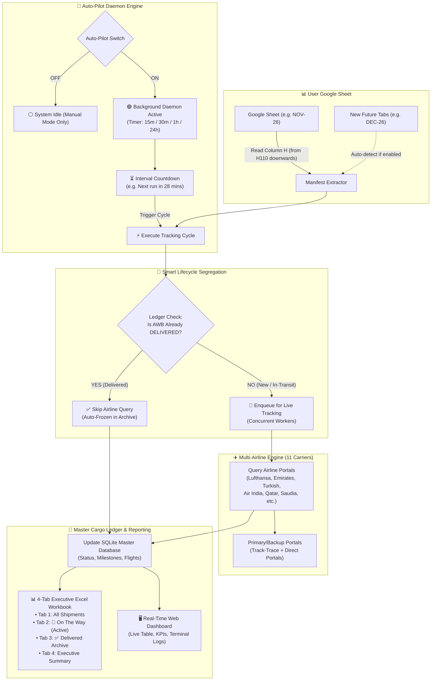

# 🤖 Global Cargo Tracker - Auto-Pilot Continuous Lifecycle Engine Guide
**Document Type:** Architecture & Operational Manual  
**Project:** Enterprise Air Cargo Multi-Carrier Tracking  
**Author:** Google DeepMind Assistant (Antigravity)  
**Version:** 2.0 (Production-Ready)  
**Language:** English & Hinglish (Bilingual Technical Guide)

---

## 📌 Executive Summary (Karyapranaali Ka Parichay)

**Auto-Pilot Continuous Lifecycle Engine** ek automated background daemon hai jo Google Sheets me add kiye gaye daily Air Waybill (AWB) numbers ko bina kisi human intervention ke monitor aur track karta hai.

Iska mukhya maksad yeh hai:
1. **Hands-Free Automatic Tracking:** User ko har ghante ya rozana aakar button dabane ki zaroorat nahi hai.
2. **Until-Delivered Lifecycle:** Ek AWB jab tak deliver nahi ho jata (chahe 2 din lagein ya 7 din), system use rozana/hourly schedule pe track karta rahega.
3. **Auto-Freezing of Delivered Cargo:** Jaise hi shipment **DELIVERED** mark ho jati hai, system use automatically **Freeze** kar deta hai aur future me airline websites pe redundant requests bhejna band kar deta hai (jisse IP ban aur rate limits se 100% bacha ja sake).
4. **Daily Incremental Sync:** Har roz sheet me aane wale 5-10 naye AWBs ko system seamlessly purane active AWBs ke sath jodkar track karta hai.
5. **Zero Duplicate Entries:** SQLite-based Master Cargo Ledger me har AWB ka ek hi single golden record rehta hai jo automatically latest milestones ke sath update hota rehta hai.

---

## 🏗️ System Architecture & Workflow Diagram

Neeche diye gaye flow chart me poora automatic lifecycle process darshaya gaya hai:

---

## ⚙️ How It Works (Step-by-Step Lifecycle Execution)

### Step 1: Sheet Ingestion & Intelligent Cell Extraction
* **Target Column:** System hamesha **Column H** ko scan karta hai jahan AWB numbers enter kiye jaate hain.
* **Configurable Start Row (H110 Rule):**
  * Agar user ne `start_row = 110` set kiya hai, to system row 1 se 109 tak ke purane records ko skip karega aur seedhe **cell H110 se neche** ke sabhi cells ko read karega.
* **11-Digit Standardization:**
  * System raw inputs se alphanumeric garbage, spaces aur hyphens hatata hai.
  * 11-digit standard AWBs (jaise `020-03680714`, `176-69448105`) ko format karta hai.
  * Agar cell me 12 digits hain (jaise row H110 me `020-037700970` jisme check digit 0 jud gaya tha), to system prefix identify karke use standard 11-digit IATA format `020-03770097` me convert kar leta hai.
* **Future Tab Detection:**
  * Agar aap agle mahine naya tab (jaise `DEC-26` ya `JAN-27`) banate hain, to **"Auto-Scan All Tabs"** option enable hone par system sheet ke sabhi tabs ke Column H ko automatically read kar lega.

---

### Step 2: Smart Ledger Check (Zero Redundant Work Rule)
Jab system sheet se AWBs extract karta hai, to wo unhe seedhe airline website pe nahi bhejta. Pehle wo local **Master Cargo Ledger (SQLite database)** check karta hai:

1. **Agar status pehle se `DELIVERED` hai:**
   * System use **Skip** kar deta hai.
   * Us AWB ke liye airline portal pe **koi network request nahi bheji jaati**.
   * Isse airline servers aapki IP block nahi karte aur API limits khatam nahi hoti.
2. **Agar status `DELIVERED` nahi hai (jaise `NEW`, `IN_TRANSIT`, `DEPARTED`, `BOOKED`, `ARRIVED` ya `UNREACHABLE`):**
   * Use **"Active / On The Way"** list me daal diya jata hai.
   * Use live tracking ke liye queue me bhej diya jata hai.

---

### Step 3: Concurrent Multi-Airline Tracking
* Active AWBs ko **Bulk Cargo Engine** ke 5 se 8 parallel workers me distribute kiya jata hai.
* Prefix ke adhar par airline pehchani jaati hai:
  * `020` ➔ Lufthansa Cargo
  * `176` ➔ Emirates SkyCargo
  * `235` ➔ Turkish Cargo
  * `098` ➔ Air India Cargo
  * `157` ➔ Qatar Airways
  * `229` ➔ Kuwait Airways
  * `703` ➔ Neos Air
  * `077` ➔ EgyptAir
  * `125` ➔ British Airways
  * `932` ➔ Virgin Atlantic
  * `312` ➔ IndiGo CarGo
* Agar kisi carrier portal pe Cloudflare/PerimeterX bot-protection active ho, to system safe fallback use karta hai (Track-Trace) aur kabhi bhi **fake ya man-ghadant data create nahi karta**.

---

### Step 4: Master Ledger Upsert & Lifecycle Categorization
Tracking result aane ke baad database me update hota hai:
* **Customer Name, Destination, IATA Agent, Pieces, Weight** Google Sheet se merge ho jaate hain.
* **Flight Numbers, Departure Dates, Arrival Times, Transit Route** live tracking se fill hote hain.
* Shipments ko do clear categories me baant diya jata hai:
  1. **🚚 On The Way / Active:** Jo abhi raste me hain. Ye agle auto-cycle me dobara track honge.
  2. **✅ Delivered Archive:** Jinki delivery complete ho chuki hai. Ye freeze ho chuke hain aur aage track nahi honge.

---

### Step 5: Daily Incremental Sync Scenario (Real-World Example)

Aapne jo example diya tha, wo system me is tarah kaam karta hai:

| Day | Sheet Me New AWBs | Purane Active AWBs | Total Scanned | Active Tracked | Delivered (Frozen) |
| :--- | :--- | :--- | :--- | :--- | :--- |
| **Day 1** | 10 naye AWBs add kiye | 0 | 10 | 10 track huye | 0 delivered |
| **Day 2** | 8 naye AWBs add kiye | 10 | 18 | 15 track huye | 3 deliver ho kar freeze huye |
| **Day 3** | 6 naye AWBs add kiye | 15 (purane) | 21 | 16 track huye | 5 deliver ho kar freeze huye |
| **Day 4** | 10 naye AWBs add kiye | 16 (purane) | 26 | 18 track huye | 8 deliver ho kar freeze huye |
| **Day 5** | 5 naye AWBs add kiye | 18 (purane) | 23 | 11 track huye | 12 deliver ho kar freeze huye |

> [!IMPORTANT]
> **Key Takeaway:** Purane jo shipments deliver hote jayenge, unka tracking load khatam hota jayega. System par sirf unhi shipments ka load padega jo **abhi actually raste me hain**!

---

## 🎛️ UI Controls & Manual vs Auto Mode

Web UI (`http://localhost:8000`) me aapko yeh controls milte hain:

### 1. Auto-Pilot Toggle Switch (ON / OFF)
* **Switch OFF:**
  * Background timer band rehta hai.
  * System apne aap koi request nahi bhejta.
  * Aap manual button (`⚡ Auto-Track Lifecycle` ya `⚡ Run Cycle Now`) daba kar jab chahein tab ek baar tracking kar sakte hain.
* **Switch ON:**
  * Background worker thread active ho jata hai.
  * Status badge green ho jata hai: `🟢 RUNNING (Every 30m)`.
  * Live countdown timer chalu ho jata hai: `Next Auto-Run in: 29m 10s`.
  * Jab timer 0 pe pahuchega, system apne aap sheet scan karke active AWBs track kar dega aur agle cycle ka countdown shuru kar dega.

### 2. Start Row Input
* Default: `110` (yaani cell **H110 se start karega**).
* Agar aapko poori sheet scan karni ho, to ise `1` ya blank kar sakte hain.

### 3. Sync Interval Selector
Aap dropdown se auto-run ki frequency choose kar sakte hain:
* `Every 15 Minutes` (Fast updates)
* `Every 30 Minutes` (Recommended / Balanced)
* `Every 1 Hour` (Standard Logistics)
* `Every 6 Hours` (Long-haul Flights)
* `Daily (Every 24 Hours)` (Once-a-day summary)

### 4. Instant Manual Trigger Button
* **`⚡ Run Cycle Now`**: Agar Auto-Pilot ON hai aur aapko timer ka intezar nahi karna, to is button ko click karke aap turant cycle run karwa sakte hain.

---

## 📥 Executive Multi-Tab Excel Export

System se aap kisi bhi waqt `📥 Download Multi-Tab Excel (.xlsx)` button click karke 4 tabs wali executive spreadsheet download kar sakte hain:

1. **Tab 1: `All Shipments`** - Sheet ke sabhi AWBs ka master data.
2. **Tab 2: `🚚 On The Way (Active)`** - Sirf un shipments ki list jo abhi transit ya flight me hain.
3. **Tab 3: `✅ Delivered Archive`** - Sirf un shipments ki list jo safely deliver ho chuki hain (with POD milestones).
4. **Tab 4: `Executive Summary`** - Airline-wise distribution, delivery percentage aur high-level logistics metrics.

---

## 🔒 Google Sheets Permission Notice (HTTP 401 Fix)

Agar kisi sheet par `401 Unauthorized` ya `Restricted Access` error aaye:
1. Google Sheet ko browser me open karein.
2. Top right me **"Share"** button click karein.
3. **General Access** me jahan **"Restricted"** likha hai, use badal kar **"Anyone with the link can view"** (ya Editor) set kar dein.
4. Save karein. Iske baad system turant sheet ko read karne lagega.
